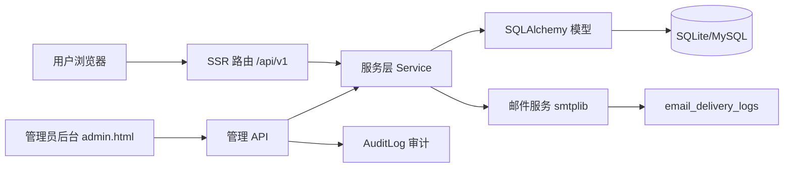

## 产品概述

在现有"自媒体互助推广平台"基础上增量新增两大模块，保持现有功能、技术栈与 UI 风格不变：

1. **薅羊毛活动社区**：面向用户的公开活动展示与互动社区，覆盖邀请助力、拼人头、组队、集卡类活动。
2. **意见反馈**：用户意见提交与"新活动提交"入口，写入数据库并通过 SMTP 邮件通知管理员，邮件失败可重试。

所有功能必须遵循"禁止欺骗性设计"最高约束：前端必须调用真实后端接口，数据库写成功后才能提示成功，不使用模拟/随机/硬编码数据冒充真实业务数据，不伪造状态、统计、评论数、活动热度或成功率。

## 核心功能

### 薅羊毛活动社区

- 首页新增"薅羊毛"精选板块，仅展示 4–6 个可配置精选活动，提供"查看更多"入口
- 活动列表页：按平台、类型、展示状态筛选，按发布时间/截止时间排序，关键字搜索，分页展示
- 活动详情页：主题、封面、富文本详情、参与入口/群二维码、来源链接、风险提示/免责声明、评论区
- 活动评论：登录用户可发表一级评论与一层回复，支持对评论/回复举报
- 活动参与入口：二维码图片或跳转链接两种类型，二维码未配置/过期/禁用/加载失败时必须如实显示状态

### 活动管理后台

- 活动平台与活动类型为可配置字典（后台维护，不硬编码），平台/类型各有预设项
- 活动 CRUD：标题、封面、平台、类型、摘要、Markdown 详情、起止时间、状态（草稿/发布/下架）、精选标记、排序、来源链接、风险提示、参与入口
- 状态规则：后台状态与实际展示态分离（进行中/即将开始/已结束由起止时间计算）；已结束不得显示为进行中；end_at 早于 start_at 禁止保存；精选仅对已发布活动生效
- 下架/删除/不合规活动不进入首页与公开列表；所有后台写操作写审计日志

### 评论与举报管理

- 公开接口只返回已审核评论；评论数来自真实评论记录
- 后台可审核/删除评论，处理活动评论举报（通过/驳回并记录处理人与处理说明）

### 意见反馈

- 用户提交反馈：分类、标题、内容、相关链接、联系方式（联系方式可选）
- "新活动提交"分类采用方式 A：选择后动态展示活动名称、平台、活动介绍、官方链接、群入口线索、截止时间、推荐理由等额外字段，校验后存入 extra_data
- 反馈状态流转：待处理/处理中/已解决/已拒绝，记录处理人、处理时间与管理员备注
- 提交后先写库，数据库成功才提示"反馈已保存"；邮件通知失败不回滚反馈，如实提示"邮件通知失败"，并支持管理员重试

### 邮件与系统配置

- 使用标准库 smtplib 发送，SMTP 密码仅从环境变量读取，不入源码、不入库、不返回前端
- 邮件发送记录写入 email_delivery_logs，记录状态、尝试次数、最后错误、发送时间
- system_settings 表保存反馈接收邮箱、邮件开关、主题前缀等非敏感配置
- 反馈提交接口做频率限制，防止刷接口

## 技术栈选择

- 后端：沿用现有 FastAPI 0.115.6 + SQLAlchemy 2.0（`Mapped`/`mapped_column`）+ Pydantic v2
- 数据库迁移：Alembic 1.14.0（新增迁移脚本，不删重建）
- 页面：Jinja2 SSR 模板 + 原生 JS fetch 调用 `/api/v1`
- 邮件：Python 标准库 smtplib + email.message
- 图片上传：复用现有 evidence_service（Pillow 校验）+ 本地存储
- 富文本：受限安全 Markdown 子集（渲染前转义，防 XSS）

## 实现方案

### 总体策略

采用与现有项目一致的"模型 + 服务 + API + SSR 路由 + Jinja 模板"分层结构，新增模块不改变现有架构。所有公开数据查询在服务层统一过滤（仅发布且未软删除），管理接口统一走 `get_current_admin` 鉴权。邮件发送作为独立服务，与反馈写入解耦，失败不抛回滚。

### 数据流



### 关键设计决策

- **活动状态双轨制**：`status`（草稿/发布/下架）为管理状态，前端展示态由 `status + start_at + end_at` 实时计算（进行中/即将开始/已结束），避免状态造假。
- **可配置字典表**：platform/type 独立成表，后台维护，公开接口与后台共用，避免硬编码。
- **评论一层嵌套**：`parent_id` 为空为一级评论，回复的 `parent_id` 指向一级评论，`reply_to_user_id` 记录被回复人；只做一层，不递归。
- **Markdown 安全渲染**：只允许标题、粗体、斜体、链接、列表、引用等子集，先 HTML 转义再渲染，链接强制 rel nofollow，阻断脚本注入。
- **邮件可靠性**：反馈提交事务先 commit 反馈记录，再同步/异步记录 email_delivery_log（状态 PENDING），发送失败置 FAILED 并保留 last_error，管理员可手动重试，重试次数上限与退避。
- **频率限制**：复用现有依赖或对反馈提交接口按用户 + 时间窗做轻量限流。

## 实现细节

### 数据模型（新增）

- `Activity`：活动主表，含软删除 `deleted_at`
- `ActivityPlatform` / `ActivityType`：可配置字典表，`code` 唯一
- `ActivityEntry`：参与入口，二维码/链接，含启用、过期时间
- `ActivityComment`：评论，一层回复，软删除
- `ActivityReport`：活动评论举报
- `FeedbackCategory`：反馈分类字典
- `Feedback`：反馈主表，`extra_data` JSON（服务层校验）
- `EmailDeliveryLog`：邮件投递日志
- `SystemSetting`：key/value 配置表

### 新增枚举

- `ActivityStatus`：DRAFT / PUBLISHED / OFFLINE
- `ActivityDisplayStatus`：ONGOING / UPCOMING / ENDED（服务层计算）
- `ActivityEntryType`：QR_IMAGE / LINK
- `FeedbackStatus`：PENDING / PROCESSING / RESOLVED / REJECTED
- `EmailDeliveryStatus`：PENDING / SENT / FAILED / UNKNOWN

### 性能与可靠性

- 公开列表查询使用分页 + 只查必需字段，避免 N+1：平台/类型/入口/评论数通过 join 或聚合查询批量获取
- 评论数使用真实 `COUNT` 聚合，不使用缓存伪造值
- 首页精选查询 `is_featured=True AND status=PUBLISHED AND deleted_at IS NULL` 并按 `featured_sort` 限制条数
- 邮件发送失败不影响反馈主流程，日志持久化便于追溯与重试

### 目录结构

```
helpEachother/
├── app/
│   ├── models/
│   │   ├── activity.py              # [NEW] Activity/ActivityPlatform/ActivityType/ActivityEntry 模型
│   │   ├── activity_comment.py      # [NEW] ActivityComment/ActivityReport 模型
│   │   ├── feedback.py              # [NEW] Feedback/FeedbackCategory 模型
│   │   ├── email_delivery_log.py    # [NEW] EmailDeliveryLog 模型
│   │   ├── system_setting.py        # [NEW] SystemSetting 模型
│   │   ├── enums.py                 # [MODIFY] 新增活动/反馈/邮件枚举
│   │   └── __init__.py              # [MODIFY] 导出新模型
│   ├── schemas/
│   │   ├── activity.py              # [NEW] 活动/评论/举报 Pydantic 请求响应模型
│   │   └── feedback.py              # [NEW] 反馈请求响应模型（extra_data 校验）
│   ├── services/
│   │   ├── activity_service.py      # [NEW] 活动查询/状态计算/管理写操作
│   │   ├── markdown_service.py      # [NEW] 受限安全 Markdown 渲染
│   │   ├── feedback_service.py      # [NEW] 反馈写入/状态流转/extra_data 校验
│   │   └── email_service.py         # [NEW] smtplib 发送 + 投递日志 + 重试
│   ├── api/
│   │   ├── activities.py            # [NEW] 公开活动列表/详情/入口
│   │   ├── activity_comments.py     # [NEW] 公开评论/回复/举报
│   │   ├── feedback.py              # [NEW] 公开反馈提交
│   │   ├── admin_activities.py      # [NEW] 后台活动/平台/类型/入口管理
│   │   ├── admin_feedback.py        # [NEW] 后台反馈处理/邮件重试/系统设置
│   │   └── __init__.py              # [MODIFY] 聚合新路由
│   ├── core/
│   │   └── config.py                # [MODIFY] 增加 SMTP 环境变量配置
│   └── web/
│       └── __init__.py              # [MODIFY] 新增 /activities、/activities/{id}、/feedback 页面路由
├── templates/
│   ├── activities.html              # [NEW] 活动列表页
│   ├── activity_detail.html         # [NEW] 活动详情页（含评论区）
│   ├── feedback.html                # [NEW] 意见反馈页（方式 A 动态字段）
│   ├── home.html                    # [MODIFY] 首页新增薅羊毛精选板块
│   ├── base.html                    # [MODIFY] 导航增加入口
│   └── admin.html                   # [MODIFY] 后台增加活动/反馈管理面板
├── static/
│   ├── css/style.css                # [MODIFY] 新增活动/反馈相关样式
│   └── js/
│       ├── activities.js            # [NEW] 活动筛选/评论/举报交互
│       └── feedback.js              # [NEW] 反馈表单动态字段与提交
├── alembic/versions/
│   └── xxxx_add_activity_feedback.py # [NEW] 新增表迁移
├── tests/
│   ├── test_activities.py           # [NEW] 活动公开接口/状态计算/管理鉴权测试
│   └── test_feedback.py             # [NEW] 反馈写入/邮件失败不回滚/重试测试
├── .env.example                     # [MODIFY] 增加 SMTP 配置示例（密码占位，不含真实值）
└── README 或部署说明               # [MODIFY] 运行部署/邮件配置/验收说明
```

## 关键代码结构

```python
# 活动展示态计算（服务层，避免状态造假）
def compute_display_status(activity: Activity, now: datetime) -> ActivityDisplayStatus:
    if activity.status != ActivityStatus.PUBLISHED or activity.deleted_at:
        return None  # 不进入公开展示
    if now < activity.start_at:
        return ActivityDisplayStatus.UPCOMING
    if now > activity.end_at:
        return ActivityDisplayStatus.ENDED
    return ActivityDisplayStatus.ONGOING

# 邮件发送结果（区分保存与发送）
class EmailSendResult:
    status: EmailDeliveryStatus  # PENDING/SENT/FAILED/UNKNOWN
    error: str | None
```

## 设计风格

延续现有平台"清晰、可信、互助社区"的整体视觉，采用卡片式布局与柔和渐变点缀。活动模块强调"真实信息"氛围：状态徽章、平台标签、截止时间清晰可读，未配置/已过期入口用灰色禁用态如实提示，不制造虚假热度。反馈页保持轻量表单风格，动态字段展开流畅自然。

## 页面设计

### 首页薅羊毛板块

- 位置：在优秀博主板块附近新增并列区块，移动端自动上下排列
- 结构：区块标题 + "查看更多"链接；精选活动卡片 4–6 个，卡片含封面、平台标签、类型标签、摘要、状态徽章、截止时间
- 交互：卡片悬停微抬升，点击进入详情页

### 活动列表页

- 顶部筛选栏：平台下拉、类型下拉、状态下拉、关键字搜索框、排序切换（最新发布/最近截止）
- 内容区：响应式卡片网格，分页控件；空结果如实显示"暂无符合条件的活动"
- 每个卡片展示真实状态徽章（进行中绿色/即将开始蓝色/已结束灰色）

### 活动详情页

- 头部：封面、标题、平台/类型标签、状态徽章、起止时间
- 主体：Markdown 渲染详情、来源链接、风险提示/免责声明
- 参与入口区：二维码图片或跳转链接；二维码缺失/过期/禁用显示明确提示，不伪装可用
- 评论区：一级评论列表 + 一层回复，登录后输入框，举报按钮；评论数来自真实数据

### 意见反馈页

- 分类选择后动态展开字段："新活动提交"展示活动名称/平台/介绍/官方链接/群入口线索/截止时间/推荐理由
- 提交结果区分："反馈已保存"与"邮件通知失败"分别提示，不混为一谈

### 管理后台扩展

- 新增"活动管理"面板：平台/类型字典维护、活动列表、编辑/发布/下架/删除、参与入口配置、精选排序
- 新增"评论举报"与"反馈管理"面板：评论审核、举报处理、反馈状态流转、邮件重试

## 推荐使用的扩展

### Skill

- **编程大神.skill**
- 用途：作为高阶全栈实现助手，接手该增量开发任务，完成模型/服务/API/模板/脚本的落地、前后端联调、真实运行验证与验收，遇到跨模块问题追到根因
- 预期结果：模块可运行、可验证，关键流程用真实入口/接口/数据库证据说明结果，不编造测试结论

### Skill

- **frontend-design**
- 用途：为活动列表页、活动详情页、意见反馈页及后台扩展面板产出高质量、风格统一的前端界面代码
- 预期结果：美观且符合现有平台风格的响应式页面，状态与空状态展示真实可信